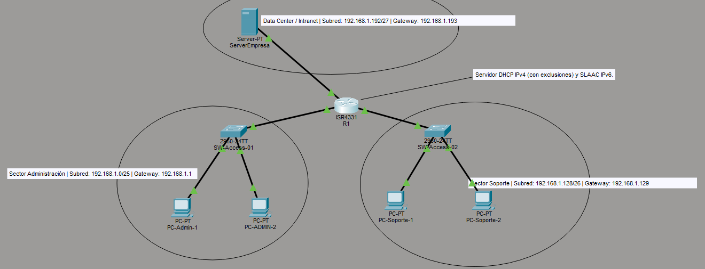
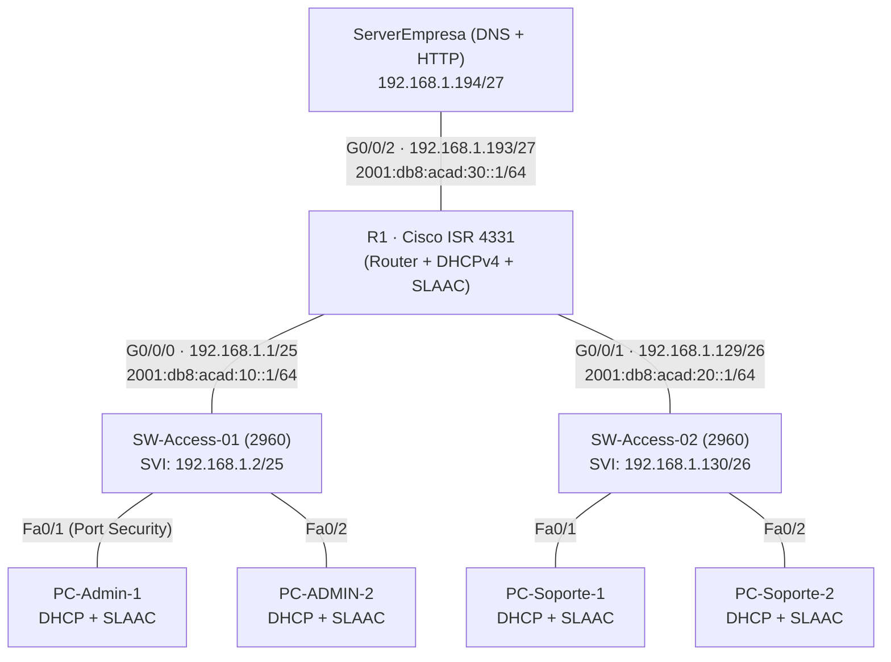
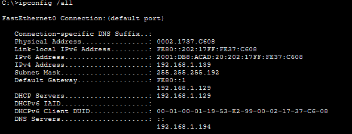
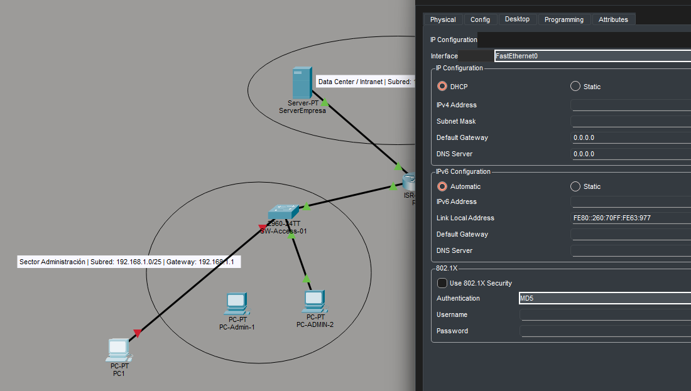
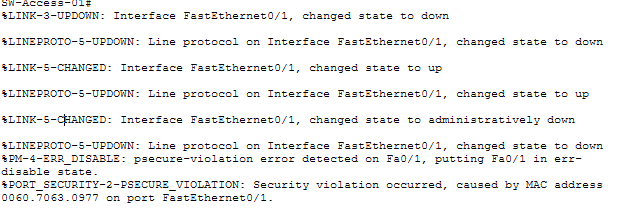

# Laboratorio de red corporativa: VLSM, Dual-Stack y seguridad L2 (Cisco CCNA, ITN)

Armé en Cisco Packet Tracer una red de oficina chica: un router ISR 4331, dos switches Catalyst 2960-24TT, cuatro PCs y un servidor interno. La dividí en tres sectores (Administración, Soporte y Data Center/Intranet) y le fui sumando subnetting con VLSM, DHCP para IPv4, SLAAC para IPv6, acceso remoto por SSH v2 y seguridad de puertos en Capa 2.

Es el segundo proyecto que subo, después del [laboratorio de Mini ISP con MikroTik](https://github.com/idersalto3/mikrotik-mini-isp-lab). Lo fui armando mientras me preparo para el examen de CCNA 1 (ITN) y para el MTCNA.

## Por qué lo armé

Soy técnico en redes y, mientras repasaba los 17 módulos de CCNA 1, me di cuenta de que una cosa es entender la teoría en un apunte (cómo funciona VLSM, qué hace ARP, cómo se maneja un switch con la tabla MAC, para qué sirve el Default Gateway en una SVI) y otra muy distinta es sentarte frente a la consola en blanco y hacerlo.

Armé esta topología para juntar en un solo escenario casi todo lo que vi en ITN y ver cómo se relacionan las capas de punta a punta: desde el cableado y el bloqueo de una MAC intrusa en un puerto, hasta el ruteo entre subredes de distinto tamaño y que una PC abra un sitio interno por nombre.

## Qué cubre y qué dejé afuera (y por qué)

Lo que sí hice:

- **Subnetting con VLSM:** partí un bloque `/24` en tres subredes a medida (`/25`, `/26` y `/27`), según cuántos hosts necesita cada sector.
- **Dual-Stack (IPv4 e IPv6):** configuré las dos versiones al mismo tiempo en todas las interfaces del router.
- **DHCPv4 en el router:** dos pools, uno por sector, con las primeras 10 IPs de cada rango excluidas para equipos de infraestructura, y el DNS entregado automáticamente.
- **IPv6 con SLAAC:** las PCs se autoconfiguran con los anuncios RA del router (`ipv6 unicast-routing`) y arman su dirección con EUI-64.
- **Seguridad básica y SSH v2 en los switches:** claves cifradas, contraseña en la consola, SVI de administración con su gateway y acceso remoto solo por SSH.
- **Port Security (Capa 2):** limité el puerto a una MAC aprendida con `sticky` y violación en modo `shutdown`. Verifiqué que aprende la MAC y que el puerto pasa a `err-disabled` cuando conecto una PC distinta.
- **Intranet (DNS y HTTP):** un servidor interno que resuelve `www.ider.com` para toda la oficina.

Lo que dejé afuera a propósito (por ahora):

- **VLANs troncales (802.1Q) y Router-on-a-Stick:** al principio tenía los dos switches conectados entre sí con un cable cruzado, pero para quedarme en el alcance de CCNA 1 (donde cada subred sale por una interfaz física del router) conecté cada switch a una boca distinta de `R1`. Los troncales quedan para un próximo laboratorio de CCNA 2 (SRWE).
- **DHCP Relay (`ip helper-address`):** podía poner el DHCP en el servidor, pero entonces tenía que configurar `ip helper-address` en el router, porque los routers no pasan los broadcasts de `DHCP Discover`. Preferí dejar el DHCP directamente en el router Cisco para practicar los comandos de IOS.
- **OSPF y salida WAN (`/30`):** dejé libre el último bloque (`192.168.1.224/27`) para más adelante sumar un segundo router con enlaces punto a punto `/30`.
- **Contraseñas fuertes:** en los switches usé claves simples (`cisco`, `Cisco123!`) a propósito. Sé que en una red real tienen que ser largas, distintas en cada equipo y bien guardadas, pero en el laboratorio entro y salgo de los equipos todo el tiempo y me comía mucho tiempo cargándolas. Lo aclaro para que no parezca una recomendación.

## Topología



Diagrama lógico con interfaces y direcciones:



## Tabla de direccionamiento y VLSM

Arranqué con la red `192.168.1.0/24` (256 direcciones) y ordené los sectores de mayor a menor cantidad de hosts:

1. **Sector Administración (hasta 100 hosts):** corté la red a la mitad con un `/25` (`255.255.255.128`), que me da 126 hosts útiles (de la `.1` a la `.126`, broadcast `.127`).
2. **Sector Soporte (hasta 50 hosts):** agarré la mitad que quedaba libre (`192.168.1.128`) y la volví a partir al medio con un `/26` (`255.255.255.192`): 62 hosts útiles (de la `.129` a la `.190`, broadcast `.191`).
3. **Data Center / Servidores (hasta 20 hosts):** tomé el bloque que sigue (`192.168.1.192`) y lo corté en `/27` (`255.255.255.224`): 30 hosts útiles (de la `.193` a la `.222`, broadcast `.223`).

| Sector | Hosts necesarios | Prefijo | Red | Rango útil | Broadcast |
|---|---|---|---|---|---|
| Administración | hasta 100 | /25 (255.255.255.128) | 192.168.1.0 | .1 a .126 | .127 |
| Soporte | hasta 50 | /26 (255.255.255.192) | 192.168.1.128 | .129 a .190 | .191 |
| Data Center / Intranet | hasta 20 | /27 (255.255.255.224) | 192.168.1.192 | .193 a .222 | .223 |
| Libre (reservado para el futuro) | no usado | /27 | 192.168.1.224 | .225 a .254 | .255 |

| Dispositivo | Interfaz | Sector / Función | IPv4 y máscara | IPv6 | Default Gateway |
|---|---|---|---|---|---|
| R1 | G0/0/0 | Gateway Admin | 192.168.1.1/25 | 2001:db8:acad:10::1/64 (fe80::1) | N/A |
| R1 | G0/0/1 | Gateway Soporte | 192.168.1.129/26 | 2001:db8:acad:20::1/64 (fe80::1) | N/A |
| R1 | G0/0/2 | Gateway Servidores | 192.168.1.193/27 | 2001:db8:acad:30::1/64 (fe80::1) | N/A |
| SW-Access-01 | VLAN 1 (SVI) | Gestión Admin | 192.168.1.2/25 | N/A | 192.168.1.1 |
| SW-Access-02 | VLAN 1 (SVI) | Gestión Soporte | 192.168.1.130/26 | N/A | 192.168.1.129 |
| ServerEmpresa | FastEthernet0 | Intranet (HTTP/DNS) | 192.168.1.194/27 (estática) | SLAAC (/64) | 192.168.1.193 / fe80::1 |
| PC-Admin 1 y 2 | FastEthernet0 | Puestos Admin | DHCP (192.168.1.11 en adelante) | SLAAC (/64) | 192.168.1.1 / fe80::1 |
| PC-Soporte 1 y 2 | FastEthernet0 | Puestos Soporte | DHCP (192.168.1.139 en adelante) | SLAAC (/64) | 192.168.1.129 / fe80::1 |

---

## Cómo lo fui armando

### 1. Enrutamiento Dual-Stack y servidor DHCP en el router (R1)

En el router configuré las tres interfaces Gigabit con sus máscaras VLSM y habilité `ipv6 unicast-routing`. Ojo con este comando: si te lo olvidás, el router no enruta IPv6 ni manda los anuncios RA para que las PCs se autoconfiguren. A las tres bocas también les puse `fe80::1` como Link-Local, así es fácil reconocerlo como gateway en cada segmento.

Para no cargar las IPs a mano en cada PC armé dos pools de DHCPv4 directamente en `R1` (`POOL-ADMIN` y `POOL-SOPORTE`). Antes excluí las primeras 10 direcciones de cada subred (`192.168.1.1` a `.10` en Admin y `192.168.1.129` a `.138` en Soporte), así el DHCP nunca reparte la IP del router ni pisa las IPs fijas de los switches o de alguna impresora futura.

```text
! ===== Configuración en R1 (Cisco ISR 4331) =====
enable
configure terminal
hostname R1
no ip domain-lookup
ipv6 unicast-routing

! Interfaz Sector Administración (/25)
interface GigabitEthernet0/0/0
 description Enlace LAN Administracion VLSM /25
 ip address 192.168.1.1 255.255.255.128
 ipv6 address 2001:db8:acad:10::1/64
 ipv6 address fe80::1 link-local
 no shutdown
 exit

! Interfaz Sector Soporte (/26)
interface GigabitEthernet0/0/1
 description Enlace LAN Soporte VLSM /26
 ip address 192.168.1.129 255.255.255.192
 ipv6 address 2001:db8:acad:20::1/64
 ipv6 address fe80::1 link-local
 no shutdown
 exit

! Interfaz Data Center / Servidores (/27)
interface GigabitEthernet0/0/2
 description Sala de Servidores VLSM /27
 ip address 192.168.1.193 255.255.255.224
 ipv6 address 2001:db8:acad:30::1/64
 ipv6 address fe80::1 link-local
 no shutdown
 exit

! Reserva de las primeras 10 IPs de cada sector para infraestructura
ip dhcp excluded-address 192.168.1.1 192.168.1.10
ip dhcp excluded-address 192.168.1.129 192.168.1.138

! Pool DHCP para Administración
ip dhcp pool POOL-ADMIN
 network 192.168.1.0 255.255.255.128
 default-router 192.168.1.1
 dns-server 192.168.1.194
 exit

! Pool DHCP para Soporte
ip dhcp pool POOL-SOPORTE
 network 192.168.1.128 255.255.255.192
 default-router 192.168.1.129
 dns-server 192.168.1.194
 end

copy running-config startup-config
```

### 2. Hardening, SVI, SSH v2 y Port Security en los switches

Los switches vienen pelados de fábrica, así que a los dos (`SW-Access-01` y `SW-Access-02`) les apliqué la seguridad básica: `enable secret`, `service password-encryption` para que las claves no queden en texto plano, `no ip domain-lookup` para que no se cuelgue cuando te equivocás al escribir un comando, un `banner motd` con el aviso de acceso restringido y `logging synchronous` en la consola para que los mensajes del sistema no te corten lo que estás tipeando.

Para administrarlos de forma remota sin usar Telnet (que viaja en texto plano) levanté `interface vlan 1` en cada switch con una IP dentro de las excluidas de su subred (`.2` en Admin y `.130` en Soporte) y le puse su `ip default-gateway` apuntando a la boca del router. Acá me quedó claro algo importante: el switch no usa el Default Gateway para conmutar las tramas de las PCs (eso lo hace en Capa 2 mirando las MAC), lo necesita solo para contestar paquetes que salen desde su propia IP de gestión hacia otra subred. Después configuré el dominio `ider.com`, generé las llaves RSA de 1024 bits y dejé las líneas VTY solo con SSH (`transport input ssh`).

En la boca `FastEthernet0/1` de `SW-Access-01` (donde está `PC-Admin-1`) activé Port Security: puerto en modo acceso, máximo 1 MAC con aprendizaje `sticky` y modo de violación `shutdown`.

Ojo con las contraseñas de estas configuraciones: son simples a propósito, lo explico arriba en "Lo que dejé afuera".

```text
! ===== Configuración en SW-Access-01 (Sector Administración) =====
enable
configure terminal
hostname SW-Access-01
enable secret Cisco123!
service password-encryption
no ip domain-lookup
banner motd #Prohibido el acceso a personal no autorizado#

line console 0
 password cisco
 login
 logging synchronous
 exec-timeout 5 0
 exit

! SVI de gestión en la subred /25
interface vlan 1
 ip address 192.168.1.2 255.255.255.128
 no shutdown
 exit
ip default-gateway 192.168.1.1

! Configuración de SSH v2
ip domain-name ider.com
! al preguntar el tamaño del módulo, ingresé 1024
crypto key generate rsa
1024
ip ssh version 2
username admin privilege 15 secret AdminPass123!

line vty 0 15
 login local
 transport input ssh
 logging synchronous
 exec-timeout 5 0
 exit

! Port Security en la boca de PC-Admin-1
interface FastEthernet0/1
 switchport mode access
 switchport port-security
 switchport port-security maximum 1
 switchport port-security mac-address sticky
 switchport port-security violation shutdown
 end

copy running-config startup-config
```

```text
! ===== Configuración en SW-Access-02 (Sector Soporte) =====
enable
configure terminal
hostname SW-Access-02
enable secret cisco
service password-encryption
no ip domain-lookup
banner motd #Acceso restringido sector Soporte#

line console 0
 password cisco
 login
 logging synchronous
 exec-timeout 5 0
 exit

! SVI de gestión en la subred /26
interface vlan 1
 ip address 192.168.1.130 255.255.255.192
 no shutdown
 exit
ip default-gateway 192.168.1.129

! Configuración de SSH v2
ip domain-name ider.com
! al preguntar el tamaño del módulo, ingresé 1024
crypto key generate rsa
1024
ip ssh version 2
username admin privilege 15 secret AdminPass123!

line vty 0 15
 login local
 transport input ssh
 logging synchronous
 exec-timeout 5 0
 end

copy running-config startup-config
```

### 3. Intranet corporativa (servidor DNS y Web)

En el segmento `/27` (`192.168.1.192/27`) conecté `ServerEmpresa` con IP fija `192.168.1.194` y gateway `192.168.1.193`. En la pestaña Services activé el servidor HTTP (edité el `index.html` para que muestre una portada propia de "ider redes") y el servicio DNS con un registro tipo A que traduce `www.ider.com` a `192.168.1.194`. Como el router ya les entrega ese DNS por DHCP, cualquier PC nueva que se enchufe en Admin o Soporte puede abrir el navegador y entrar al sitio interno por nombre.

---

## Cómo lo verifiqué

**1. Tabla de enrutamiento y estado de interfaces en `R1`.** Con `show ip interface brief` y `show ip route` revisé que las tres interfaces estuvieran `up/up` y que el router reconociera los tres cortes de distinta máscara (`/25`, `/26` y `/27`) dentro de la red `192.168.1.0/24`:

```text
R1#show ip interface brief
Interface              IP-Address      OK? Method Status                Protocol
GigabitEthernet0/0/0   192.168.1.1     YES NVRAM  up                    up
GigabitEthernet0/0/1   192.168.1.129   YES NVRAM  up                    up
GigabitEthernet0/0/2   192.168.1.193   YES manual up                    up

R1#show ip route
     192.168.1.0/24 is variably subnetted, 6 subnets, 4 masks
C       192.168.1.0/25 is directly connected, GigabitEthernet0/0/0
L       192.168.1.1/32 is directly connected, GigabitEthernet0/0/0
C       192.168.1.128/26 is directly connected, GigabitEthernet0/0/1
L       192.168.1.129/32 is directly connected, GigabitEthernet0/0/1
C       192.168.1.192/27 is directly connected, GigabitEthernet0/0/2
L       192.168.1.193/32 is directly connected, GigabitEthernet0/0/2
```

**2. IPv6 y SLAAC.** En `R1` revisé con `show ipv6 interface brief` las direcciones GUA y Link-Local. Después, al tildar Automatic en las PCs, comprobé que se asignaran su IPv6 `/64` con EUI-64 y tomaran `FE80::1` como gateway:

```text
R1#show ipv6 interface brief
GigabitEthernet0/0/0       [up/up]
    FE80::1
    2001:DB8:ACAD:10::1
GigabitEthernet0/0/1       [up/up]
    FE80::1
    2001:DB8:ACAD:20::1
GigabitEthernet0/0/2       [up/up]
    FE80::1
    2001:DB8:ACAD:30::1
```

Del lado del cliente lo confirmé en `PC-Soporte-1` con `ipconfig /all`: tomó la IPv4 `192.168.1.139` por DHCP (la primera libre después de las 10 excluidas), con gateway `192.168.1.129` y DNS `192.168.1.194`, y por SLAAC generó la IPv6 `2001:DB8:ACAD:20:202:17FF:FE37:C608`, donde se ve el `FF:FE` típico del EUI-64 armado a partir de su MAC, con `FE80::1` de gateway.



**3. Port Security en `SW-Access-01`.** Después de generar tráfico desde `PC-Admin-1`, vi que el puerto estaba en `Secure-up` y que la MAC de la PC se había pegado por `sticky`:

```text
SW-Access-01#show port-security interface fastEthernet 0/1
Port Security              : Enabled
Port Status                : Secure-up
Violation Mode             : Shutdown
Maximum MAC Addresses      : 1
Total MAC Addresses        : 1
Sticky MAC Addresses       : 1
Last Source Address:Vlan   : 00D0.9740.EB45:1
Security Violation Count   : 0
```

Después probé la violación: conecté otra PC (`PC1`) en `Fa0/1` de `SW-Access-01`, en lugar de `PC-Admin-1`. El enlace quedó caído (en rojo en Packet Tracer) y la PC, que estaba en DHCP, no recibió ninguna IPv4. El log del switch lo confirma: `psecure-violation error detected on Fa0/1, putting Fa0/1 in err-disable state`, con la MAC de la PC intrusa (`0060.7063.0977`) como causa.





**4. Ruteo entre subredes, SSH cruzado y acceso web.**

- Hice ping entre `PC-Admin-1` (/25) y `PC-Soporte-1` (/26) y respondió en menos de 1 ms con TTL=127, o sea que el paquete descontó un salto al pasar por `R1`.
- Probé SSH hacia los dos switches (`ssh -l admin 192.168.1.2` y `ssh -l admin 192.168.1.130`): muestran el banner de acceso restringido y piden la clave local.
- Sumé una máquina nueva (`PC-ADMIN-2`), activé DHCP y tomó sola la `192.168.1.12` (respetando las 10 excluidas) y abrió `www.ider.com` en el navegador a la primera.

## Problemas que me encontré y qué aprendí

- **Superposición de subredes (`overlaps with GigabitEthernet0/0/0`):** cuando quise cargar `192.168.1.129 255.255.255.192` en la segunda interfaz (G0/0/1), el IOS me tiró `% 192.168.1.128 overlaps with GigabitEthernet0/0/0`. Pasaba que la primera interfaz había quedado con máscara `/24` (`255.255.255.0`), que ocupaba de la `.0` a la `.255`. Ahí entendí que para hacer VLSM primero tenés que achicar la máscara de la primera boca a `/25` (`255.255.255.128`) para liberar la otra mitad de la red.
- **El cable cruzado entre los switches:** en la primera versión tenía `SW-Access-01` y `SW-Access-02` unidos entre sí. Cuando quise separar dos subredes me di cuenta de que, si los switches están conectados en la misma VLAN por defecto, forman un único dominio de broadcast y las subredes se mezclan. Para quedarme en el nivel de CCNA 1 saqué ese cable y conecté cada switch a su propia boca del router, y ahí entendí bien por qué cada sector lleva un Default Gateway distinto (`.1`, `.129` y `.193`).
- **Pasar de IP estática a DHCP con Port Security activo:** cuando cambié `PC-Admin-1` de IP fija a DHCP pensé por un segundo que el switch me iba a bloquear el puerto. No pasó, seguía en `Secure-up`, y ahí terminé de asentar la diferencia de capas: Port Security trabaja en Capa 2 y mira solo la MAC de la placa (`00D0.9740.EB45`), así que la IP de Capa 3 puede cambiar las veces que quiera sin disparar ninguna violación.
- **Errores tontos con SSH y DNS:** al principio SSH me fallaba por dos cosas clásicas: escribí `-1` (número uno) en vez de `-l` (L minúscula de login), y apunté a la IP `.1` (el gateway del router, donde todavía no tenía SSH) en vez de a la `.2` o `.130`, que son las SVI de los switches. Además, en el DNS del servidor había pegado el dominio con formato de texto y me devolvía `Host Name Unresolved`, hasta que limpié el registro A y dejé `www.ider.com` en texto plano.

---

## Próximos pasos

- [ ] Agregar un segundo router (`R2`) conectado por un enlace WAN `/30` (`192.168.1.224/30`) y rutear ambas sucursales con rutas estáticas y OSPF.
- [ ] Reemplazar los enlaces físicos separados por VLANs y enlaces troncales 802.1Q (Router-on-a-Stick).
- [ ] Implementar listas de control de acceso (ACLs) para permitir que Soporte acceda a la Intranet pero no a las máquinas de Administración.

## Tecnologías y conceptos

Cisco Packet Tracer, Cisco IOS, ISR 4331, Catalyst 2960-24TT, VLSM, IPv4 e IPv6 (Dual-Stack), DHCPv4, SLAAC (EUI-64), SSH v2, SVI, Port Security (sticky), DNS y HTTP.

## Archivos del repositorio

El archivo de Packet Tracer (`.pkt`) está en la carpeta `packet-tracer/`, para que lo puedas abrir y recorrer.

## Sobre mí

Soy Técnico Universitario en Redes Informáticas y Telecomunicaciones (Universidad Siglo 21) y estoy cursando la Licenciatura en Informática, con 26 materias aprobadas. Desde 2020 trabajo de forma independiente brindando soporte técnico a usuarios, con tareas de hardware, software, Windows, conectividad y redes domésticas. Mi objetivo es desarrollarme profesionalmente en redes e infraestructura, con especial interés en proveedores de Internet y cooperativas. Continúo formándome mediante cursos y laboratorios prácticos con Cisco Packet Tracer y MikroTik RouterOS.

LinkedIn: [linkedin.com/in/idersalto](https://www.linkedin.com/in/idersalto)

---

Todas las credenciales, IPs y configuraciones de este repositorio corresponden a un laboratorio aislado, no a una red real.
